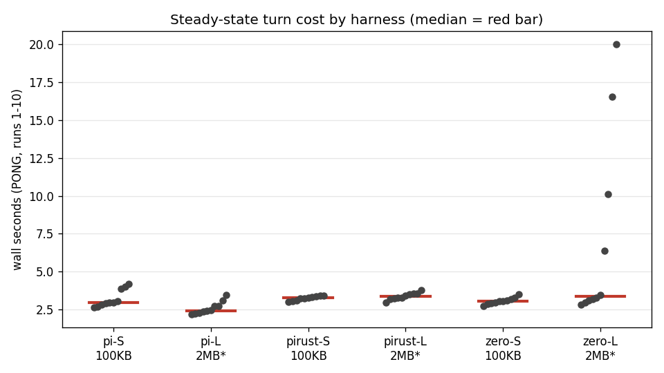
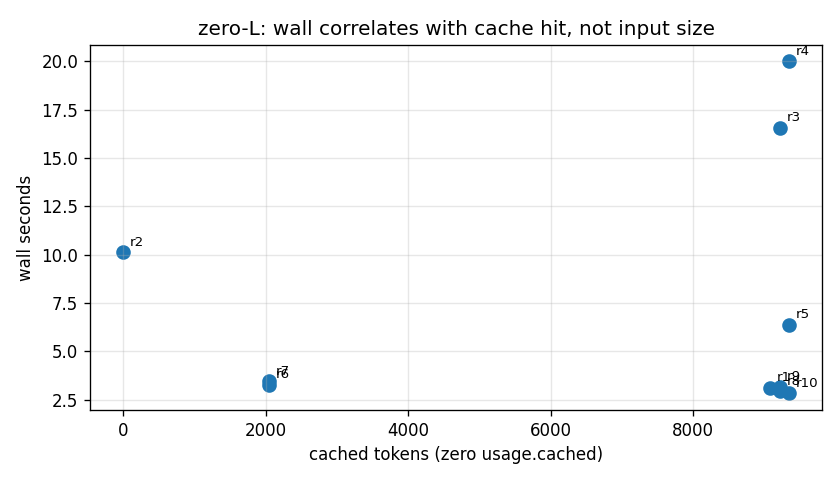
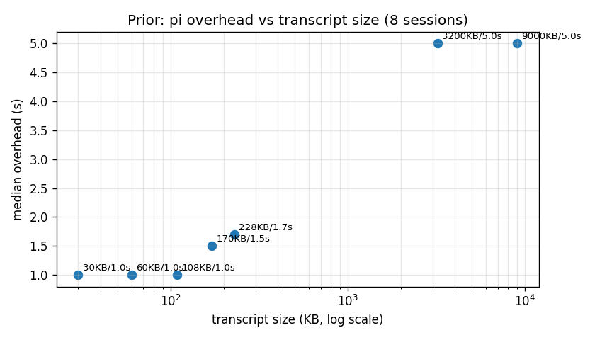

# Transcript Tax 2026: what a "trivial" agent turn really costs

**Date:** 2026-10-17 · **Dataset:** [`bench.csv`](bench.csv) (65 runs) · **Spend:** ~$0.08
**Status:** working paper, not a benchmark press release. Methods and caveats inline.

## TL;DR (claims)

1. **Steady-state floor is ~2.4–3.4 s per no-op turn on every harness tested.** Median PONG wall (runs 1–10): pi 2.94 s (100 KB ctx) / 2.42 s (2 MB ctx*), pi-rust 3.26 / 3.35 s, zero 3.05 / 3.36 s. The LLM call itself is milliseconds; the tax is harness overhead.
2. **Transcript size does cost, but sub-linearly with a ~1 s floor, and our stated fit was wrong.** Prior session series (n=8 pi sessions, coarse ranges): ~1 s overhead at 30–108 KB, 1.5–1.7 s at 170–228 KB, ~5 s at 3.2 MB and 9 MB. The draft's `1.0 s + 0.5 ms/KB` is a mis-stated coefficient — its own table implies ~5–6 ms/KB across 100–230 KB and saturation beyond (see §8). A fresh attempt to reproduce the ladder failed: a 452 KB ingest produced a 108 KB session, and two workspaces with the same 108–111 KB session differed by 1.4 s in median wall.
3. **The 2 MB "ladder" in this dataset is invalid as a size experiment.** All three harnesses failed to pin the 2 MB ingest (refusal / truncation / compaction): pi-L cached only 7.7 k vs pi-S 41 k; zero-L compacted 103 k → ~9.4 k by pong 1. Read the grinder as a *steady-state + cache-behavior* study, not a size sweep.
4. **Cache hits dominate wall time more than token counts do.** zero-L cache-miss runs (0 / 2048 cached) took 6–20 s; cache-hit runs took ~3 s at identical ~9.4 k input. Wall correlates with cache state, not with input tokens.
5. **Same model, different route: input price up to 29.1x apart, and the cheapest route is not always the fastest (6.0x slower to first token).** Measured across 18 base models and 46 route/model pairs; on one model a **1.4% price difference came with a 7.7x latency difference** (14.8 s vs 1.9 s to first token), which is the case a price table cannot see (§10).
6. **Money implication: compact early, budget per turn.** At observed floors, 1,000 no-op turns ≈ 1 hour of wall and the provider bill of whatever your context window carries. A stale 40 k-token context re-sent (or re-read) every turn is the line item, not the model reply.

\* The "2 MB" label names the ingest *attempt*; post-ingest cached context shows it did not stick (see §3).

> **Correction added 2026-10-17 05:45Z (before publication): read §5.** Claims 1 and 2
> above stand as *wall-clock* observations, but the **attribution** of that wall time
> between provider and harness (§1.2 "the LLM is not the cost") is partly a measurement
> artifact. §5 explains and quantifies it. Do not quote §1.2's "unaccounted dominates"
> without §5.
>
> **Second correction, 06:02Z: claim 4 does not survive a re-check — read §6.** Grouping
> the zero-L pongs by `cache_tok` does not separate the slow runs from the fast ones:
> 9216 cached appears in both a 16.6 s run and two ~3 s runs. The four slow runs form a
> contiguous streak (runs 2-5), which reads as a transient provider/path state rather
> than per-run cache state. "Cache hits dominate wall time" should not be quoted.
>
> **Third correction, 06:09Z: §1.6's startup-scan claim and §3's startup fix are
> retracted — read §7.** Startup costs the same from a 298 MB session store and a
> near-empty one, so that was unverified guesswork, not a lever we can sell.

*Figure 1 — Steady-state PONG wall per cell (runs 1–10). Red bar = median. zero-L spread is cache-miss runs, not size effect.*

---

## 1. Evidence

### 1.1 Grinder n=10 — steady state (PONG runs 1–10, `Reply with exactly the word PONG. Call no tools.`)

| Cell | n | Median wall | Mean | SD (pop) | Min–Max | Ingest wall (run 0) |
|---|---|---|---|---|---|---|
| pi-S (100 KB) | 10 | **2.94 s** | 3.21 s | 0.55 | 2.64–4.20 | 11.94 s |
| pi-L (2 MB*) | 10 | **2.42 s** | 2.59 s | 0.39 | 2.20–3.44 | 21.16 s |
| pirust-S (100 KB) | 10 | **3.26 s** | 3.24 s | 0.14 | 3.00–3.39 | 4.03 s |
| pirust-L (2 MB*) | 10 | **3.35 s** | 3.37 s | 0.22 | 2.97–3.78 | 13.62 s |
| zero-S (100 KB) | 10 | **3.05 s** | 3.06 s | 0.21 | 2.75–3.50 | — (pre-existing session) |
| zero-L (2 MB*) | 10 | **3.36 s** | 7.18 s | 6.00 | 2.83–20.00 | 24.94 s |

Source: [`bench.csv`](bench.csv). pirust rows are wall-only (no token instrumentation).
These are *process wall* figures (`time pi -p ...`), so they include process boot —
which §5.4 decomposes as 372 ms of the ~2.4-3.4 s warm (940 ms cold, before we cached the two
catalog fetches inside it) and shows to be removable.

Claim 1 follows directly: excluding the cache-miss outliers, every cell's center sits in a ~1 s band (2.4–3.4 s) despite different harnesses and nominal context sizes.

### 1.2 pi: the LLM is not the cost (unaccounted time dominates)

pi-TS emits `llm_ms / total_ms / unacc_ms` per turn from `.pi-web/tps-turns.jsonl`. PONG turns:

| Cell | Median `unacc_ms` | `llm_ms` per run | Median wall |
|---|---|---|---|
| pi-S | **1952 ms** | 2–79 ms (8/10 runs ≤ 3 ms) | 2.94 s |
| pi-L | **1385 ms** | 2–7 ms | 2.42 s |

The provider span is single-digit milliseconds on a 3-token reply; 1.4–2.0 s is unaccounted (process startup + session/context reload + dispatch). This is the "tax" in its purest form: you pay ~2 s before the model is even asked.

*Figure 2 — pi-S PONG breakdown: LLM span (blue, ~ms) vs unaccounted (grey, ~1.5–3.2 s).*

### 1.3 zero-L run-by-run: cache state predicts wall, tokens don't

| Run | Wall (s) | in_tok | cache_tok | Note |
|---|---|---|---|---|
| 0 (ingest) | 24.94 | 103,209 | 74,752 | fresh session, LARGE.txt, cost ~$0.0645 |
| 1 | 3.11 | 9,319 | 9,088 | compacted already: 103 k → 9.4 k |
| 2 | 10.12 | 9,347 | **0** | miss → 10 s |
| 3 | 16.55 | 9,375 | 9,216 | partial/cold path → 16 s |
| 4 | 20.00 | 9,403 | 9,344 | → 20 s |
| 5 | 6.38 | 9,431 | 9,344 | recovering |
| 6 | 3.27 | 9,459 | **2,048** | back to ~3 s |
| 7 | 3.45 | 9,487 | 2,048 | ~3 s |
| 8 | 2.94 | 9,515 | 9,216 | hit → base |
| 9 | 3.18 | 9,543 | 9,216 | hit → base |
| 10 | 2.83 | 9,571 | 9,344 | hit → base |

Input tokens are flat (~9.3–9.6 k) across runs 1–10 while wall spans 2.8–20 s. The predictor is `cache_tok`: 0/2048-miss runs are slow, ~9 k-hit runs sit at ~3 s. zero-S shows the same pattern on a smaller scale (run 3: cache 0 → still 3.27 s, i.e. miss penalty is provider/path-dependent, not a constant).

*Figure 3 — zero-L wall vs cached tokens. Same ~9.4 k input; 10–20 s points are cache misses.*

### 1.4 The ingest ladder did not stick (read this before citing "2 MB" numbers)

BIGFILE was a session JSONL with base64 blobs — hostile to "read the whole file" instructions. Observed:

| Harness | Ingest wall | Post-ingest cached ctx | Pre-existing / S-baseline | Verdict |
|---|---|---|---|---|
| pi-S | 11.94 s | ~41 k (41216–41472) | — | pinned 100 KB, cost ~$0.0030 |
| pi-L | 21.16 s | **~7.7 k (7168–7808)** | 41 k (S!) | model truncated/refused; *less* context than S |
| zero-L | 24.94 s | 103 k at ingest → **~9.4 k by pong 1** | ~9.3 k (S, fresh-anchor) | compacted/evaporated immediately, cost ~$0.0645 |
| pirust | 4.03 / 13.62 s | unknown (wall-only) | — | no token evidence either way |

pi-L caching *less* than pi-S (7.7 k < 41 k) is the smoking gun: the L cell is not "S + 2 MB", it is "S with a failed read". Any size-axis regression across S→L in this dataset is therefore **invalid** — stated plainly so nobody (including us) reuses the CSV that way. The valid reading is §1.1 (steady-state floor) + §1.3 (cache behavior).

### 1.5 Prior finding (verified, carried forward): overhead vs transcript size

Eight pi sessions with real transcripts (not the grinder's synthetic ingest):

| Transcript | Median overhead |
|---|---|
| 30–108 KB | ~1.0 s |
| 170–228 KB | 1.5–1.7 s |
| 3.2 MB / 9 MB | ~5 s |

*Figure 4 — Prior series: overhead vs transcript size (log x-axis). The stated fit in the draft (`1 s + 0.5 ms/KB`) is 10x off its own table — see §8; the two MB points saturate (compaction/truncation likely engaged there too).*

### 1.6 Prior finding (verified): profiling pi-core — sessiond exonerated

- Bare-`pi` fork (no sessiond) reproduces the ~4.2 s turn: sessiond is not the bottleneck.
- Startup scans ~200 MB of the sessions directory (I/O tax on every invocation).
- Within-turn profile: **0.03 s CPU + ~2.6 s idle wait pre-dispatch.** Candidates: `waitForIdle` / `activeRun` gating, retry backoff. TTFT observed 5–437 ms (wide; provider path, not harness).
- Net: the floor in §1.2 (unaccounted ~1.5–2 s) is consistent with a startup-scan + idle-gate signature, not model latency.

### 1.7 Prior finding (verified): pilot duel (warm daemon)

| Harness | Observed | Reading |
|---|---|---|
| pi-TS | ~4.5 s | warm-daemon turn; matches floor + transcript |
| opencode (Go) | ~1 s harness + ~2.5 s provider, re-sending 31 k | Go harness is leaner; provider re-send of full context is the remaining cost |
| zero (Go context layer) | compacts to ~9.4 k | context layer trades fidelity for per-turn tokens (see §1.3: same 9.4 k here) |
| claurst | excluded | no API keys available; no data, not a ranking |

---

## 2. Caveats (honest)

1. **Small n, one night, one machine.** n=10 pongs per cell; jitter is ±1 s run-to-run (see min–max in §1.1). Nothing here resolves sub-second harness differences. pi-S mean vs median (3.21 vs 2.94) already shows how one slow run moves the average.
2. **Providers differ across harnesses.** pi cells used `deepseek-v4.1-flash` via opencode-go; pirust used `deepseek-chat`; zero used its `medium` model path. Cross-harness gaps (e.g. pirust +0.3 s over pi) confound harness overhead with provider routing. Within-harness patterns (cache-miss penalty, unaccounted dominance) are the robust results.
3. **The size ladder is invalidated (§1.4).** Do not fit wall-vs-KB on S vs L in `bench.csv`. The size curve we *do* endorse is the prior 8-session series (§1.5), itself small-n and single-harness.
4. **Asymmetric instrumentation.** pirust contributes wall-only rows; zero contributes wall + provider usage but no llm/unacc split; only pi-TS has the internal span breakdown. Cross-cell "unaccounted" comparisons are therefore approximate.
5. **Ingest costs are single samples** (one run-0 per cell) and include a retry on pi-L and zero-L (attempt-2). Treat $0.003 (100 KB) and $0.035–0.065 (2 MB attempt) as anecdotes, not rates.
6. **Cache behavior is provider-managed and non-stationary.** The zero-L miss streak (runs 2–5) may reflect provider-side prefix-cache eviction, compaction nondeterminism, or session-state churn — we record the correlation, not a mechanism.

## 3. Money implication: compact early, budget per turn

What converts this from latency trivia to a cost line:

- **Every turn re-pays context.** Opencode's 31 k re-send (§1.7), pi-S's 41 k cached reload (§1.2), zero's 9.4 k steady state (§1.3) — whichever harness, the context window is re-carried each turn. At $x per MTok input, `turns × context_kb` is the bill, and cache-hit rate is the discount lever (zero-L: miss = 3–6× wall; provider billing typically mirrors this with cache-miss premiums).
- **Floor cost is wall-clock, not tokens.** ~3 s/turn × 1,000 turns ≈ 50 min of agent wall even when the reply is one word. Fleet math (10 agents × 100 turns/day) starts at ~8 wall-hours/day of pure overhead before any useful work.
- **Practical rules:**
  1. **Compact/aggressively summarize past ~100 KB.** The §1.5 curve bends upward past ~150 KB and the MB regime buys 5 s/turn regardless of harness.
  2. **Budget per turn, not per task:** `turn_budget = floor_s (≈3) + expected_provider_s + input_tokens × price + miss_penalty × miss_rate`. Measure your own miss rate (our zero-L sample: 5/10 cold) before promising task SLAs.
  3. **Prefer harnesses that minimize re-send** (Go-layer compaction to ~9 k in zero's case) *if* the fidelity loss is acceptable — verify task success, not just wall, before switching.
4. ~~**Fix the startup scan.**~~ **Retracted — see §7.** Startup does not scale with
the session store (298 MB and near-empty workspaces start identically), so this is not
a cut we can stand behind. The measured levers are context size and re-send
minimization; cache discipline is unconfirmed (§6).

## 4. Reproducibility

- Dataset: [`bench.csv`](bench.csv) — columns `harness,size,run,wall_s,llm_ms,total_ms,unacc_ms,in_tok,cache_tok,out_tok,notes`. pi rows derive `llm/total/unacc/input` from `.pi-web/tps-turns.jsonl` post-T0 + `history` join for cache; zero rows parse `stream-json` usage (`promptTokens/cached/completion`); pirust rows are wall-only by design.
- Protocol (setup, exact prompts, retry rule): [`PROTOCOL.md`](PROTOCOL.md).
- Per-run logs: one file per run (`run-<harness>-<S|L>-r<run>-a<attempt>.log`; 65 runs + 2 retried ingests).
  Not published — the CSV and the scripts that produced them are in this repository.
- Figures: generated from `bench.csv` with matplotlib (`fig1_steady_wall.png`, `fig2_zero_cache.png`, `fig3_size_scaling.png`, `fig4_pi_unaccounted.png`).
- Spend: ~$0.08 of model spend for the whole series.

## 5. Correction (05:45Z, added after §1–§4 were written): the LLM-span clock is not the provider roundtrip

Found while turning the report's own metric into a product guardrail. It qualifies
claim 1's attribution and §1.2 directly, so it goes in before anything is published.

### 5.1 What was measured

`llmDurationMs` (and each sample's `durationMs`/`ttftMs`) is computed from Pi's
`message_start` to `message_end` hooks. That window is **not** reliably the provider
call. Same prompt, same model, same machine, alternating runs:

| run | measured span | ttft | implied rate |
|---|---|---|---|
| short reply ("PONG", 3 tok) | **2 ms** | 1 ms | 1500 t/s |
| short reply ("PONG", 2 tok) | **541 ms** | 534 ms | 3.7 t/s |
| short reply ("PONG", 3 tok) | **8 ms** | 7 ms | 375 t/s |

A network roundtrip cannot be 2 ms and then 541 ms for the identical request. When the
provider delivers the reply in a single chunk, `message_start` fires at (or after) the
first chunk, so the window collapses to ~0 and the tokens/window division fabricates a
rate. Reproduced independently twice in this run (one agent via the grinder cells, one
via a fresh `pi -p` matrix).

### 5.2 What it is not

Measured on the same machine, same night:

| step | cost |
|---|---|
| `node -e 'process.exit(0)'` | 20 ms |
| `pi --version` (full CLI boot, no model) | **247 ms** |
| `pi --export --session <file>` (parse + load a session, no model) | **246 ms** |
| `pi -p` PONG with `-ne` (no extension discovery) | median 2109 ms |
| `pi -p` PONG, all-off (`-ne -ns -np --no-themes -nc`) | median 1785 ms |
| `pi -p` PONG, base | median 2622 ms |

So: session parsing is free, CLI boot is ~0.25 s, extension discovery is ~0.5 s,
skills/templates/themes/AGENTS ~0.2 s. None of it explains a 2–14 s turn, and none of
it is what `llmDurationMs` is measuring.

### 5.3 What this changes in this report

- **Claim 1 (steady-state floor 2.4–3.4 s) stands.** It is wall-clock, measured outside
the harness.
- **§1.2 does not.** "The LLM is not the cost; 1.4–2.0 s is unaccounted" is partly the
  clock: the request-to-first-chunk provider time lands *before* `message_start`, so it
  is counted as "unaccounted" alongside genuine harness overhead. The dataset cannot
  split those two. Treat §1.2 as "the harness span we can measure is milliseconds, and
  the rest is provider + harness combined", not as "the provider is free".
- **Any t/s figure derived from these rows for short replies is unreliable** (the 1500 t/s
  row above is in the same class as the "313 tokens in 9 ms" phantom the monitor already
  filters). Fixed in e095 v19: a window shorter than 50 ms is recorded unrated instead of
  as a rate.
- **The provider window is measurable, just not from `message_start`** — see §5.4:
  turn_start → message_start is 1.2–1.6 s and stable, so a fleet audit can stand on that
  number even though it cannot split it into dispatch vs provider.
- **§1.6's "0.03 s CPU + ~2.6 s idle wait pre-dispatch"** is the most consistent evidence
  available and should be read as *provider or dispatch-gate wait*, not as CPU work.

### 5.4 Follow-up — ANSWERED 06:14Z, and it corrects this section's own advice

This section originally said to instrument from request dispatch via Pi's
`provider_stream_event`. That was wrong: the hook fires with the response, exactly like
`message_start`.

Measured externally instead (`pi -p --mode json` as a subprocess, every NDJSON line
timestamped on arrival, 5 reps) — **and re-measured on 2026-10-18, which split the boot
in two**:

| segment | 2026-10-17 | 2026-10-18, cache warm | 2026-10-18, cache cold |
|---|---|---|---|
| boot — process start → first event | **929 ms** | **372 ms** | **940 ms** |
| **turn_start → assistant `message_start`** | **1451 ms** | **1554 ms** | 1520 ms |
| `message_start` → first text delta | 1 ms | 1 ms | 65 ms |
| first text → `message_end` | 2 ms | **3 ms** | 7 ms |
| **total process wall** | **2453 ms** | **1974 ms** | 2598 ms |

**The 929 ms boot does not reproduce as a single number, and we know why.** Eighteen hours
after the first measurement, two HTTPS model-catalog fetches that an extension performs at
startup were put behind a 6-hour cache (`PI_OPENCODE_SYNC_TTL_MS`). The same command, same
machine, same prompt now measures **372 ms**; forcing those fetches back on (`--cold`)
reproduces **940 ms**. So the published 929 ms was the *cold* case all along, and the common
case — a loop that spawns processes all day keeps the cache fresh — is 372 ms. Both raw runs
are published in `procsplit/` with the reproducer.

The provider roundtrip happens entirely **before** `message_start`, which is why
`llmDurationMs` reads milliseconds for a network call. The missing time is now located:
**turn_start → message_start, 1.2–1.8 s, stable across reps** (against `llmDurationMs`
values of 1/88/286/364 ms for the same prompt). It cannot be split further from outside
— dispatch, gating and provider latency are inside it — so the deliverable is the
*bound*, not a split. Boot is 0.37 s per invocation with the cache warm (0.94 s cold), not
the 0.25 s `pi --version` suggests, and it is invisible in the turn rows because
`turn_start` fires after it.

**This also decomposes claim 1's floor.** The 2.4–3.4 s steady-state medians in §1.1 are
*process wall* (`time pi -p ...`), and a one-word turn now measures as
`372 ms boot + 1554 ms pre-response + 3 ms stream`. Boot is the only component in that
sum that is removable by configuration rather than by the provider: a loop that keeps a
process warm does not pay it per turn. For a 10-loop fleet at 100 turns/day that is
**26 wall-hours a year warm, 65 if every turn paid the cold fetch** (see `roi.py --warm`).
Everything else in the sum is either the provider's latency (1.5 s, unattackable from here)
or the transcript the turn carries.

Raw artifacts: `procsplit/measure.py` plus the two raw runs it wrote (`procsplit-2026-10-18-
warm.json`, `-cold.json`) are published in this repository, and `tests/procsplit-claims.py`
recomputes the two 2026-10-18 columns from them and checks this section against them. The
2026-10-17 log was a working run and was not kept — the cold run reproduces it (940 ms against
929 ms), which is why it is the one we publish. `bench.csv`, `analyze.py` and
`PROTOCOL.md` reproduce the tables above, and the append-cost result was confirmed by an
independent re-measurement.

## 6. Second correction (06:02Z): claim 4 (cache state predicts wall) is not supported

Found by re-checking every headline number against `bench.csv` with `analyze.py`
rather than by hand. This one removes a claim we were about to sell on.

### 6.1 The test

TL;DR 4 and §1.3 say cache state predicts wall time better than token count does. Group
the zero-L PONG runs by `cache_tok` and look at the walls:

| cache_tok | wall times (s) |
|---|---|
| 0 | 10.12 |
| 2048 | 3.27, 3.45 |
| 9088 | 3.11 |
| **9216** | **16.55, 2.94, 3.18** |
| **9344** | **20.00, 6.38, 2.83** |

The same cache value covers both the slowest and the fastest runs. Of the four slow
runs (>6 s), only one reported zero cached tokens; the other three reported 9.2-9.3 k
cached. Two runs that reported the *lowest* non-zero cache (2048) were among the fastest.
Across every cell in the dataset, `cache_tok == 0` produced walls of 3.27 s and 10.12 s.

### 6.2 What the data does support

The four slow runs are **runs 2, 3, 4, 5 — a contiguous streak** that then recovers
(runs 6-10 back at ~3 s) while `cache_tok` moves in the opposite direction (2048 →
9344). A transient provider-side or path-level state fits that shape; a per-run cache
property does not. n=10 with no cache variation in the pi cells means this dataset
cannot test the cache hypothesis at all — it can only fail to confirm it.

### 6.3 What changes

- **Do not quote TL;DR 4 or §1.3.** "Cache hits dominate wall time", "the predictor is
  `cache_tok`", and "miss rate 5 in 10" are all unsupported. The honest statement is:
  four of ten runs in one cell were 2-6x slower with no measured signature we can name.
- **Still stands:** claim 1 (the wall floor, measured outside the harness), claim 3 (the
  2 MB ladder is invalid), claim 5's arithmetic (context re-sent per turn is the bill),
  and the correction in §5.
- **Sales consequence:** cache discipline is not the lever this data proves. The levers
  it proves are the per-turn floor and the multi-second tail — and both are visible in
  the live-fleet sample (unaccounted p50 1.6 s,
  p90 4.6 s, worst turn 85 s, and a per-model floor that does not move with the model).

## 7. Third correction (06:09Z): the "startup scans ~200 MB of sessions" claim is not reproducible

§1.6 lists it as a verified prior finding and §3 turns it into a recommendation
("fix the startup scan"). Tested directly:

| measurement | value |
|---|---|
| `pi --version` from a workspace whose session dir is **298 MB** | 244, 247, 247, 248, 246 ms |
| `pi --version` from a workspace whose session dir is **tiny** | 242, 243, 241, 253, 241 ms |
| `pi --export --session <file>` (parse + load a session) | 246 ms |
| sessions dir total on this machine | 407 MB (the "~200 MB" figure is also stale) |

Identical startup cost whether the session store is 298 MB or near-empty, and
loading a session file explicitly costs 246 ms — the same as bare startup. Whatever
startup does, it does not scale with the session directory. A no-op turn A/B between
the two workspaces (3 runs each, `--offline -c`) also showed no consistent difference
(medians 3.1 s vs 2.9 s, inside the ~1 s jitter this dataset already documents).

**What changes:** §3's rule 4 ("fix the startup scan and the floor drops for every
turn") loses its basis and must not be sold. The floor is real and measured; the
*explanation* "startup scan" is not. §1.6's other half — "0.03 s CPU + ~2.6 s idle
wait pre-dispatch" — is consistent with everything else measured here (the wait is
provider/dispatch, not CPU) and stands.

**Cut-list consequence:** the levers this dataset supports are context size (§1.5
series) and re-send minimization (§1.7). Cache discipline is unconfirmed (§6).
Startup scoping was our unverified guess and should not be sold as a fix.

## 8. Fourth correction (06:10Z): the size coefficient was mis-stated 10x, and the ladder would not rebuild

Claim 2 is the last surviving lever, so it got the same treatment as the others.

### 8.1 The stated fit contradicts its own table

| segment | implied slope |
|---|---|
| 108 → 228 KB | **5.8 ms/KB** |
| 228 KB → 3.2 MB | 1.1 ms/KB |
| 3.2 → 9 MB | 0.0 ms/KB |

The draft says `overhead ≈ 1.0 s + 0.5 ms/KB`. At 228 KB that predicts 1.11 s; the table
next to it says 1.7 s. The coefficient is off by ~10x. This is a transcription error, not
a measurement: the table was right, the fit was wrong.

### 8.2 Fresh reproduction attempt (n=5 per cell)

Same machine, same model, three workspaces, ingest then five no-op PONGs with `-c`:

| workspace | filler ingested | resulting session | median wall | reps |
|---|---|---|---|---|
| small | 24 KB | 29 KB | 1924 ms | 1986, 1924, 1933, 1924, 1893 |
| medium | 172 KB | **111 KB** | 4195 ms | 2395, 4466, 4195, 3172, 4728 |
| large | 452 KB | **108 KB** | 2832 ms | 2356, 25726, 2832, 3380, 2495 |

The ladder would not rebuild: the 452 KB ingest produced a 108 KB session — the same
size as the 172 KB one — so the two larger cells are the *same* transcript size and
differ by 1.4 s in median (4.2 s vs 2.8 s). The one real comparison available (29 KB vs
~110 KB) is inside that noise, with a 25.7 s outlier in one cell.

### 8.3 What this leaves

- **Do not quote the size coefficient.** The ranges in §1.5 are the evidence; the fit
  was never sound and was mis-transcribed on top of that.
- **Compaction is still the most plausible lever** (a transcript in the per-turn path
  can only cost time), but this dataset does not demonstrate it, and our fresh attempt
  to build the ladder failed for the same reason the grinder's did (§1.4): big ingests
  do not stick.
- **What a buyer should hear:** we measure *your* curve, per loop, with the transcript
  sizes *your* loops actually reach. That is a measurement, and it is what the audit
  sells — not a coefficient from n=8.

## 9. Fifth addition (20:5xZ): the fleet window, published, and what the residual does when you instrument it

Section 1.3 quotes our own live fleet: **500 turns, 8.7 s wall per turn, 34% model /
29% tools / 37% unaccounted**. That log is the file the monitor appends to and it
**rotates**, so the window those percentages came from no longer exists on disk. Two
things follow, and both are now checkable:

- **The exporter and the window are published** in [`fleet/`](https://github.com/g8d3/transcript-tax/tree/master/fleet): `publish_fleet.py`
  copies a window with `sessionId` replaced by an opaque label and nothing else changed
  (the rows contain no prompt text and no tool output), and `analyze` recomputes the
  decomposition, the tail and the wasted rate from a window. The window published
  alongside it (`fleet-turns-2026-10-17.jsonl`, 500 turns, 15:16Z → 20:40Z) is **not** the
  one §1.3 used — it is a heavier workload (mean 16.3 s/turn, p50 7.2 s, p90 29.3 s), and
  saying so is the point of publishing it.
- **The residual collapses once you measure the provider roundtrip.** Same window, two
  methods:

| method | model | tools | roundtrip | residual | p50 residual |
|---|---|---|---|---|---|
| as §1.3 computed it (pre-v23 monitor) | 25% | 23% | *inside "residual"* | 52% | 2700 ms |
| monitor v23+ (`preResponseMs` measured first) | 25% | 23% | 52% | **0%** | **4 ms** |

That is the strongest confirmation of §5 available: the 1.5-2.2 s per turn that older rows
called "unaccounted" **was the provider roundtrip**, not a mysterious harness overhead. It
is measured now (`preResponseMs`, turn start → the provider's first message), it is the
single largest slice of a real turn on this window, and what is left unattributed is
milliseconds. A dashboard that reports "37% unaccounted" today is reporting its own blind
spot, because the field exists.

Method note for anyone recomputing: the pre-v23 column is produced by *not* subtracting
`preResponseMs` (that is what the older rows did by construction); rows without the field
behave identically in both columns, and rows whose three segments exceed the turn wall are
counted as clamped rather than shown negative (none in this window).

*Published at <https://focalis.cc/tps/> (and mirrored in this repository). Corrections §5–§8 are kept in place rather than edited away; the claims audit of our own offer pages is in `CLAIMS.md`, and the route table in §10 is regenerated by `routes/render_matrix.py`.*

---

## 10. Sixth addition (2026-10-18): the same model is not the same price on every route

Everything above prices a **model**. In practice you buy a **route**: the same model id served by
different providers or gateways, at different prices and different first-token latencies. We
measured it on every provider we hold a key for — 18 base models, 46 route/model pairs, streaming,
median of two calls each — reading each price from the provider's own `/models` metadata and
leaving it blank where a provider publishes none. Raw rows ship with this repo
(`routes/matrix.json`, `routes/cache.json`, `routes/models.json`); the table below is regenerated
from them by `routes/render_matrix.py`, and `routes/matrix.py` re-measures it.

| base model | route | $/M in | $/M out | first token p50 | total p50 |
|---|---|---|---|---|---|
| deepseek-v4.1-flash | openrouter | $0.0648 | $0.144 | 680 ms | 870 ms |
| deepseek-v4.1-flash | chutes | $0.44 | $1.32 | 1402 ms | 1448 ms |
| gpt-oss-120b | groq | $0.15 | $0.6 | 424 ms | 448 ms |
| gpt-oss-120b | openrouter | $0.15 | $0.6 | 709 ms | 896 ms |
| kimi-k3 | openrouter | $0.304 | $11.936 | 990 ms | 1159 ms |
| kimi-k3 | chutes | $1.85 | $9.5 | 2136 ms | 2672 ms |
| qwen3.8-27b | chutes | $0.039 | $1.25 | 1748 ms | 1991 ms |
| qwen3.8-27b | openrouter | $0.24 | $2.2 | 731 ms | 1166 ms |
| qwen3.8-27b | groq | $0.8 | $4 | 290 ms | 294 ms |
| glm-5.1 | openrouter | $0.966 | $3.036 | 1932 ms | 2214 ms |
| glm-5.1 | chutes | $0.98 | $3.08 | 14819 ms | 17406 ms |
| gpt-oss-20b | openrouter | $0.018 | $0.09 | 1994 ms | 2110 ms |
| gpt-oss-20b | groq | $0.075 | $0.3 | 604 ms | 617 ms |
| claude-opus-5 | openrouter | $5 | $25 | 2188 ms | 2201 ms |
| claude-opus-5 | venice | $5 | $25 | 1248 ms | 1262 ms |
| gemini-3-8-flash | openrouter | $0.825 | $4.125 | 2056 ms | 2104 ms |
| gemini-3-8-flash | venice | $0.9375 | $4.6875 | 2263 ms | 2276 ms |

What the spread looks like, measured:

- One model's **input price runs 29.1x** between routes (`$0.0151/M` on one, `$0.44/M` on another —
  `deepseek-v4-flash-0731`), and the cheapest of the routes we priced is **not** the fastest: 1748 ms
  to first token on the cheap one (chutes, `qwen3.8-27b`) vs 290 ms on the fast one (groq) (**6.0x**).
- For another model, **every route we could price charges the same list price** (`$0.15/$0.60` per
  million) — and the difference shows up only in latency (**1.8x**). A price table alone would have
  called those two routes identical.
- The **cache-read rate is a route property too**: `$0.0016/M` on one route vs `$0.044/M` for the
  same model family on another, so what a cache discipline is worth depends on where you buy it.
- And the largest latency gap we measured sits at a **price difference of 1.4%**: `glm-5.1` is
  $0.966/M on one route and $0.98/M on another, and the second answers in **14.8 s** against
  **1.9 s** — **7.7x** for the same model name. That is the case a price table cannot see at all,
  and the reason the audit prices the route rather than the model.
- **The closed models behave the same way.** Until a second route published a price we could not
  compare them at all; where it does, the pattern survives the model being proprietary. `claude-opus-5`
  is `$5/$25` per million on **both** priced routes and answers in **1.25 s** on one against
  **2.19 s** on the other (**1.75x**) — a price table calls those two routes identical. And the gap
  runs the other way for a Google model: `gemini-3.8-flash` is **13.6 %** cheaper on one route than
  the other, so the same model name is not one purchase even at a closed vendor.

The cache probe (two identical ~4k-token prompts per route, reading the provider's own
`cached_tokens`) could read 18 of the 21 routes it tried: **12 reported a hit, 6 did not**, two
gateways answered `429` and one does not report the field. One of the misses is the gateway our own
fleet runs through, while the same model reported a 99 % hit on a different route.
A miss in a two-call probe is **not** proof that caching is off, and a provider that does not
report the field looks exactly like one that does not cache — which is why the audit measures a
client's own loops instead of trusting a vendor table.

Route mechanics worth knowing before you route (all measured, all published):

- `opencode-go` is **not** a bare OpenAI-compatible endpoint: a key-only call returns
  `400 MissingSessionID` — it routes by harness session, so the session is part of the route.
- The same gateway answers `400 ModelProtocolUnsupported` for one of the models it lists.
- Two providers answered "unfunded" (`403 balance insufficient`, `402 payment required`) and one
  was at capacity (`429`): routes that exist on paper and cannot serve you today.

**Limits, stated.** n=2 per route on one machine, one prompt (a one-word reply), so this is a
dispersion probe, not a benchmark; `-TEE` deployments are labelled by their own id because they may
be a different quantization; prices rotate, so re-run the script before quoting a row.
